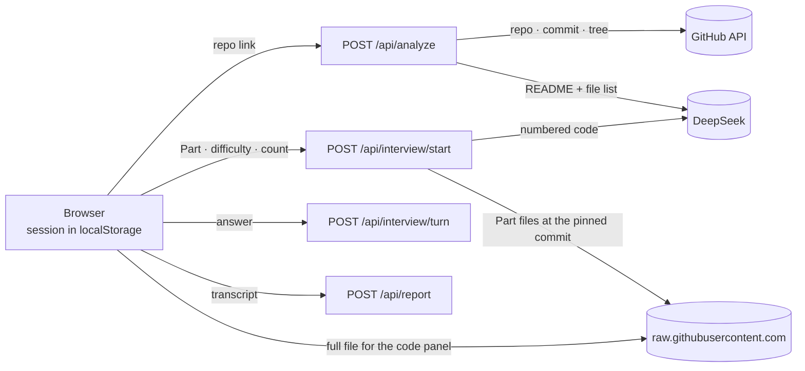
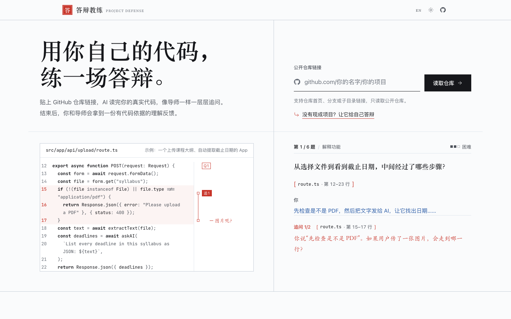
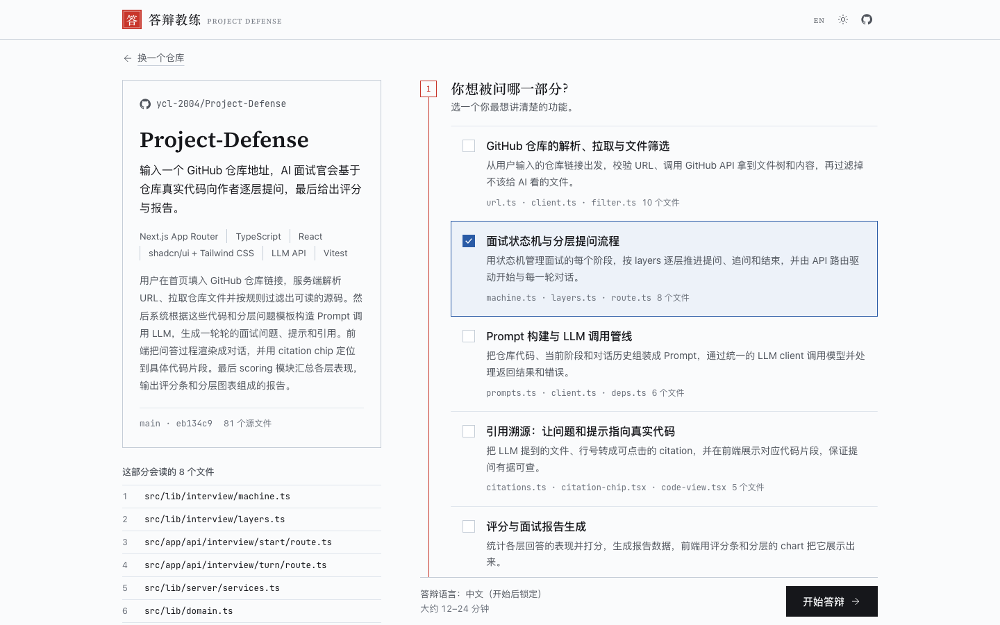
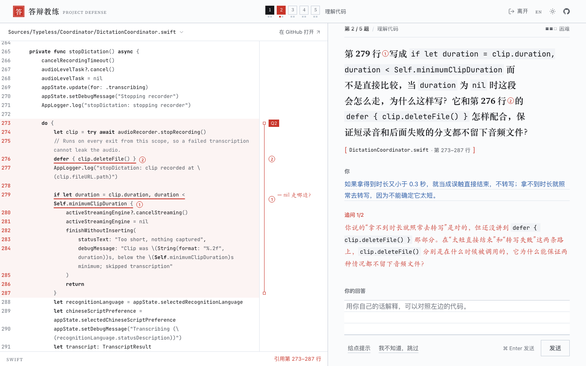
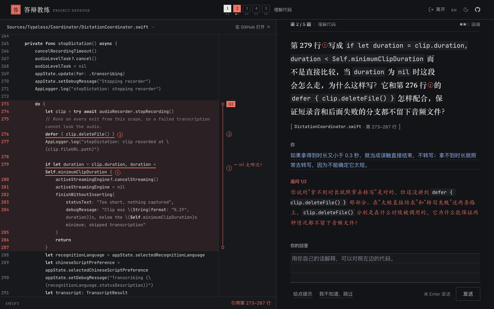
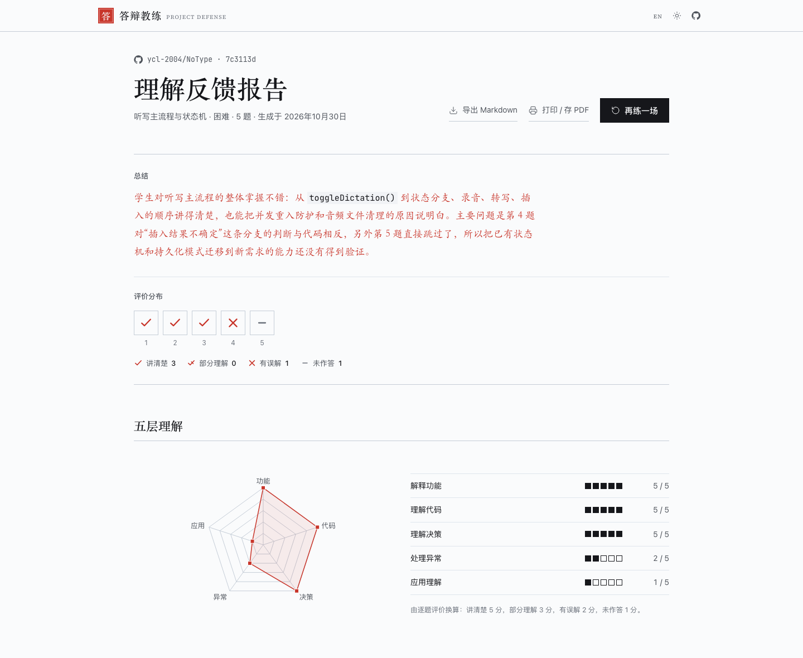
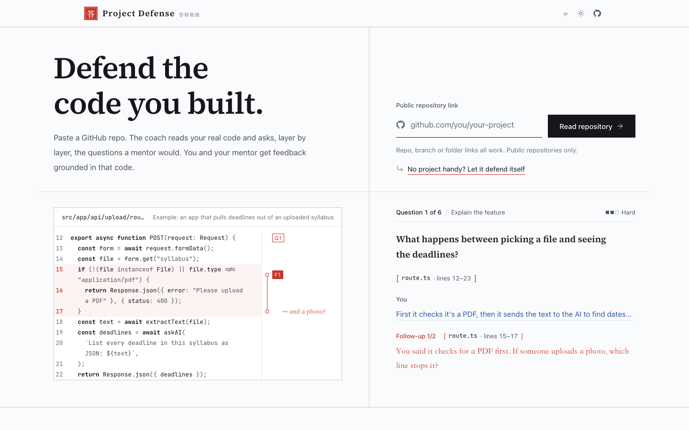

<p align="center">
  
</p>

<h1 align="center">Project Defense · 答辩教练</h1>

<p align="center">
  <strong>Students paste a public GitHub repo and practise explaining the code they built. The coach asks layered questions about real lines, follows up on vague answers, and writes feedback a mentor can check.</strong>
</p>

<p align="center">
  <a href="https://project-defense-pink.vercel.app"></a>
  
  
  
  <a href="https://github.com/ycl-2004/Project-Defense/actions/workflows/ci.yml"></a>
</p>

<p align="center">
  <a href="https://project-defense-pink.vercel.app"><strong>Open the live site</strong></a> ·
  <a href="#quick-start">Quick start</a> ·
  <a href="#how-it-works">How it works</a> ·
  <a href="#screenshots">Screenshots</a> ·
  <a href="#privacy">Privacy</a> ·
  <a href="#deploy-to-vercel">Deploy to Vercel</a> ·
  <a href="#build-from-source">Build from source</a> ·
  <a href="README.zh-TW.md">繁體中文</a>
</p>

Teenagers in AI programming courses can now ship a working app in a weekend, often without being able to say how it works. Project Defense is a rehearsal for the moment someone asks. A student pastes the link to their repository, picks the part they want to talk about, and answers five to eight questions that climb from "what happens" to "what would you change". Every question points at specific lines of their code.

The coach does not hand out a score. It records evidence: what the student said, next to what the code does. Mentors get a report they can verify line by line, plus one small code change to ask for next. The site has no accounts and no database; the session lives in the student's browser.

<p align="center">
  
</p>

<p align="center"><sub>A real session on the live site. Waits for the AI are sped up four to six times; everything else is real time.</sub></p>

> **Status (2026-10-30):** Live at <https://project-defense-pink.vercel.app>, deployed from `main` on Vercel. Version `0.1.0`. Verified so far: 76 unit tests, two Playwright tests with mocked AI, a production `next build`, a full browser session against the real DeepSeek API on this repository (analyse → plan → follow-up → hint → report), and `npm run eval:live` on this repository and [`vercel/ms`](https://github.com/vercel/ms), where every cited line matched the real file.

## Quick start

```bash
git clone https://github.com/ycl-2004/Project-Defense.git
cd Project-Defense
npm install
cp .env.example .env.local    # then put your DeepSeek key in DEEPSEEK_API_KEY
npm run dev
```

Open <http://localhost:3000>, paste a public repository link, or press **No project handy? Let it defend itself** to run a session on this repository.

### Requirements

- Node.js 20.9 or later (developed on Node 24.4) and npm.
- A [DeepSeek API key](https://platform.deepseek.com/). The default model is `deepseek-flash`.
- Optional: a GitHub token, see below.

| Variable | Required | Purpose |
| --- | --- | --- |
| `DEEPSEEK_API_KEY` | Yes | Server-side key for the DeepSeek API. Never sent to the browser. |
| `DEEPSEEK_MODEL` | No | Defaults to `deepseek-flash`. |
| `GITHUB_TOKEN` | Recommended | A fine-grained token with **Public repositories (read-only)** access and no permissions. Raises the GitHub API limit from 60 to 5,000 requests per hour, which matters on shared hosting. |
| `ACCESS_CODE` | No | When set, visitors must enter this code before the site calls the AI. |

## Why Project Defense

**Questions come from the real code.** Each question cites a file and a line range. The snippet the student sees is cut on the server from the commit the session is pinned to, so the model can point at code but can never invent it.

**Follow-ups react to the answer.** If a student says "it saves to a database", the coach asks what is saved, why, and how it comes back after a refresh. Up to two follow-ups per question; the cap is enforced on the server.

**Evidence, not a score.** Each question is rated *clear*, *partial*, *misconception* or *unanswered*, with the student's words set against the code. There is no total score, and the report says plainly that it is not a cheating verdict.

**Made for teaching.** Students can ask for hints or say "I don't know" without losing the session. The report ends with a concrete change for the mentor to ask for, because changing code and explaining why is stronger evidence than any quiz.

## Features

**Reading a repository**
- Accepts repository, branch and folder links (`github.com/owner/repo/tree/branch/folder`), public repositories only.
- Pins the session to one commit and skips dependencies, lockfiles, build output, binaries and files over 100 KB.
- Reads the README and file tree, then proposes three to six *Parts*: features a student could explain end to end. Students can also describe a Part in their own words.

**The session**
- Difficulty: **Easy** (what the code does), **Hard** (why it is built this way), **Tricky** (counterfactuals, edge cases, change requests).
- Five to eight main questions across five layers: explain the feature → understand the code → understand decisions → handle failure → apply it.
- Code beside the conversation: the full file with the cited range bracketed on a centre rail, the lines a question names underlined in red and circled ①②, and the mentor's short margin note beside its line. Follow-ups that cite other lines move the panel with them.
- Hints (up to three per question), skip, and a retry path that keeps a typed answer if the network fails.

**The report**
- Summary, a strip with one segment per question, and a five-layer radar with the exact scores beside it.
- What the student explained well, misunderstandings to fix, topics to learn next with the related files, and the mentor's next check.
- Expandable review per question: cited code, the whole conversation, evidence and feedback.
- **Export Markdown** for a self-contained file; **Print / Save PDF** expands every question and always prints in the light palette.

**Everywhere**
- Chinese and English interface. The session language is fixed when the session starts.
- Light and dark themes that follow the system until the user picks one. Keyboard-friendly controls; `⌘ Enter` sends an answer.

## How it works



1. **Analyse.** Three GitHub API calls (repository, commit, tree) plus the README. The model returns an overview and the Parts; file paths it names are checked against the tree.
2. **Plan.** The Part's files (at most 40 files, 300 KB) are sent with line numbers. The model writes one question per layer slot, cites lines, and adds a margin note of a few words pinned to one of them. Each citation is checked against the real file; if any is wrong the model is told exactly what failed and asked again, up to three attempts.
3. **Turn.** After each answer the model decides between a follow-up and the next question. Thinking mode is off here, so a turn takes a few seconds.
4. **Report.** The model rates every question. Questions the student skipped are rated *unanswered* by rule, and the radar is computed from the ratings (clear 5, partial 3, misconception 2, unanswered 1), so the same answers always draw the same chart.

The server keeps no state. The browser holds the session and sends what each call needs; request bodies are size-limited and validated with zod. Repository text and student answers are fenced as data in the prompt, and the rules live only in the system prompt, so instructions hidden in a README cannot change the coach's behaviour.

Measured on 2026-10-30 against this repository with `deepseek-flash`:

| Step | Time |
| --- | --- |
| Analyse repository | 11 s |
| Plan six questions | 13–17 s |
| Follow-up decision | 1.7–3.7 s |
| Hint | 1.8 s |
| Report | 13–18 s |

Design decisions are recorded in [`docs/decisions/`](docs/decisions/), and the visual system in [`DESIGN.md`](DESIGN.md).

## Screenshots

| Home | Pick a part |
| --- | --- |
|  |  |
| **Session** | **Session, dark** |
|  |  |
| **Report** | **English interface** |
|  |  |

Captured with Playwright at 1440 × 900 from the local server on 2026-10-30. The session and report show real `deepseek-flash` output for this repository.

## Privacy

- **No accounts, no database.** The session (repository, questions, answers, report) is stored in the browser's `localStorage` under `project-defense:v1`. Two cookies remember the language and theme (`pd-locale`, `pd-theme`).
- **What leaves the browser.** The browser sends the repository link, the chosen file paths and the student's answers to this site's server. The server reads the public files from GitHub and sends file contents and answers to the DeepSeek API, whose own data policy applies. The browser also loads full files directly from `raw.githubusercontent.com` for the code panel.
- **Nothing is kept on the server.** Requests are handled and forgotten; errors are logged with a code and a short message.
- **Public code only.** Private repositories are refused. Do not paste secrets into answers.

## Deploy to Vercel

1. Sign in to [vercel.com](https://vercel.com) with GitHub.
2. **Add New → Project**, import `Project-Defense`. Vercel detects Next.js; keep the default build settings.
3. Under **Environment Variables** add `DEEPSEEK_API_KEY`, and preferably `GITHUB_TOKEN`. Add `ACCESS_CODE` if the site should not be open to everyone.
4. **Deploy.** Every push to `main` redeploys.
5. Open `/api/health` on the new site to check the configuration. It reports whether the DeepSeek key is set and whether GitHub accepts the token (a valid token shows a limit of 5,000), without ever returning a key.

The API routes set `maxDuration` between 60 and 180 seconds, inside the Hobby plan's 300-second limit. The site spends the owner's DeepSeek credit, so keep a small balance on the account or set `ACCESS_CODE`.

## FAQ

<details>
<summary>The page says the site's AI key isn't configured.</summary>

`DEEPSEEK_API_KEY` is missing on the server. Locally, put it in `.env.local` and restart `npm run dev`; on Vercel, add it under Environment Variables and redeploy.
</details>

<details>
<summary>How do I know the GitHub token works?</summary>

Open `/api/health`. `tokenAccepted: true` with a `limit` of 5,000 means GitHub accepted it; a limit of 60 means the site is running without a token.
</details>

<details>
<summary>"GitHub's read limit is used up."</summary>

Without a token GitHub allows 60 API requests per hour per IP address, and shared hosting IPs run out quickly. Set `GITHUB_TOKEN` to a fine-grained token with public read-only access.
</details>

<details>
<summary>Can it read private repositories?</summary>

No. The first version reads public repositories only, which keeps the token harmless and the privacy story simple.
</details>

<details>
<summary>Why is there no total score?</summary>

A few questions cannot prove understanding, and a single number invites people to treat it as a verdict. The report shows per-question evidence instead. See [`docs/decisions/001-evidence-not-scores.md`](docs/decisions/001-evidence-not-scores.md).
</details>

<details>
<summary>Which languages does it support?</summary>

Any repository whose source is text. Syntax highlighting covers common languages (TypeScript, JavaScript, Python, Go, Rust, Java, Kotlin, Swift, C/C++, C#, PHP, Ruby, Dart, Vue, Svelte and more); others show as plain text.
</details>

## Build from source

<details>
<summary>Commands</summary>

```bash
npm install
npm run dev          # http://localhost:3000
npm run lint         # ESLint (Next.js core-web-vitals + TypeScript)
npm run typecheck    # tsc --noEmit
npm test             # Vitest unit tests, no network
npm run test:e2e     # Playwright main flow; builds and starts the app, AI and GitHub are mocked
npm run eval:live    # Optional: real DeepSeek + GitHub on two public repos (needs .env.local, costs a few cents)
npm run build && npm start
```

CI runs lint, typecheck, unit tests, a production build and the Playwright test on every push and pull request. CI needs no secrets.
</details>

## Project layout

```text
src/
  app/                  pages (/, /setup, /interview, /report) and API routes under api/
  components/           home, setup, interview, report, shared UI; ui/ holds shadcn/ui primitives
  lib/
    domain.ts           shared types and zod schemas
    config.ts           every product limit in one place
    github/             link parsing, file filtering, GitHub client
    interview/          layers, state machine, citations, scoring, prompts, Markdown export
    llm/                DeepSeek client with JSON checks and retries
    server/             services behind the API routes, dependency wiring, HTTP shell
    client/             browser store, API client, highlighter, hooks
    i18n/messages.ts    every visible string in Chinese and English
tests/                  Vitest unit tests (fake GitHub and fake model)
e2e/                    Playwright main-flow test
evals/                  optional live evaluation against the real APIs
docs/                   decisions, screenshots, application summary
```

## Versioning and releases

The version lives in `package.json` (currently `0.1.0`). There are no tagged releases yet; the deployed site will track `main`.

## Known limitations

- Public GitHub repositories only; other hosts are not supported.
- One Part reads at most 40 files and 300 KB; files over 100 KB are skipped, and only the first 1,500 files are listed to the model.
- The coach can be wrong. Ratings are evidence for a mentor to check, not grades.
- Reports live in one browser; there is no shareable link yet.
- Tested in Chromium on desktop and at 390 px mobile width. Safari and Firefox are not yet verified; the colour system uses CSS `light-dark()`, which needs Safari 17.5, Chrome 123 or Firefox 120.
- Answers are not streamed; long steps show progress instead.
- There is no rate limiting beyond the optional access code.

## License

No license has been chosen yet. Until a license file is added, all rights are reserved by the author.
