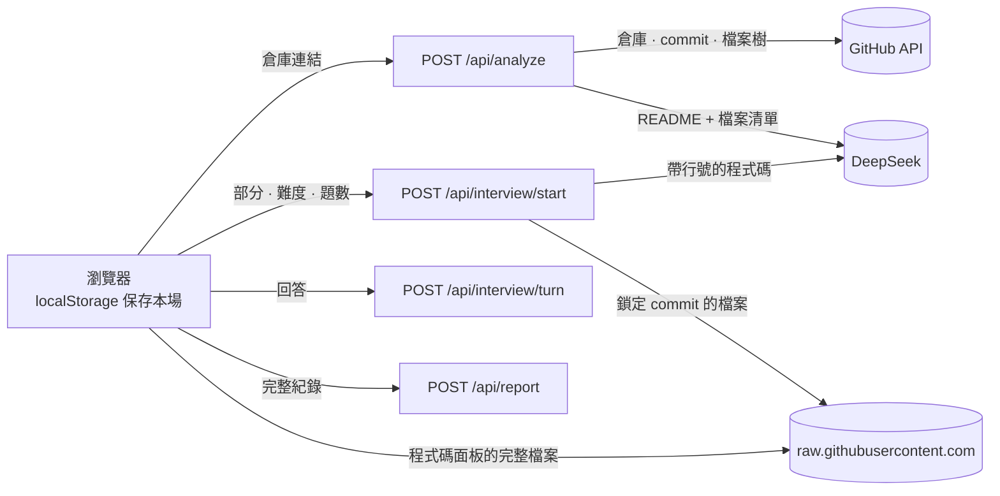
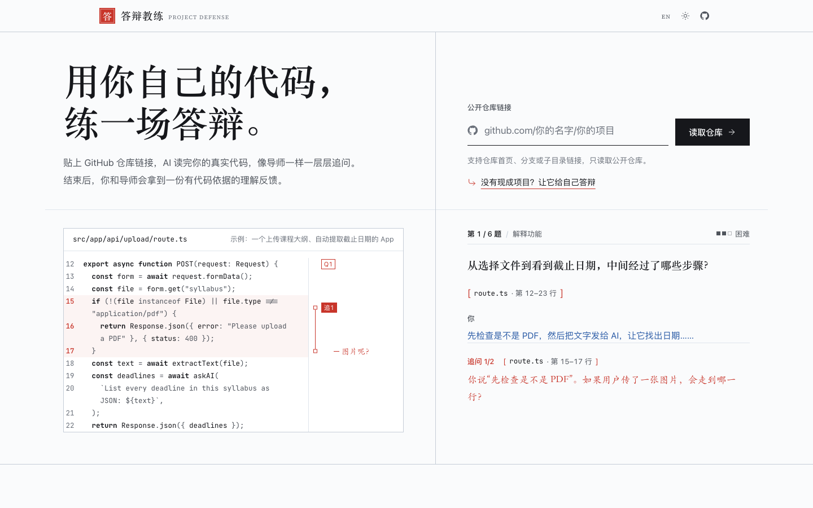
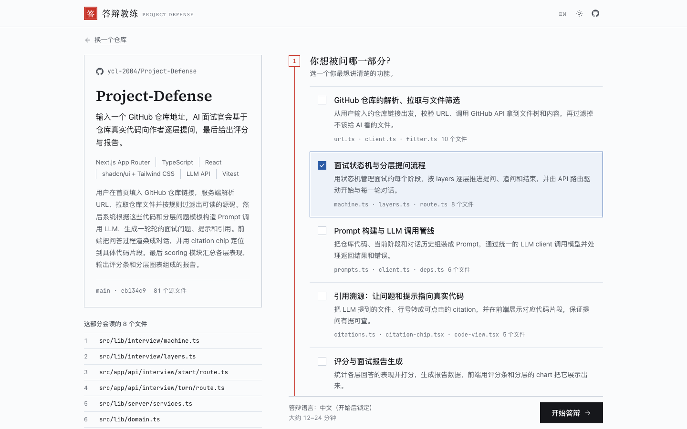
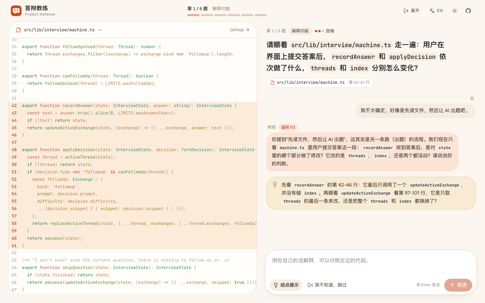
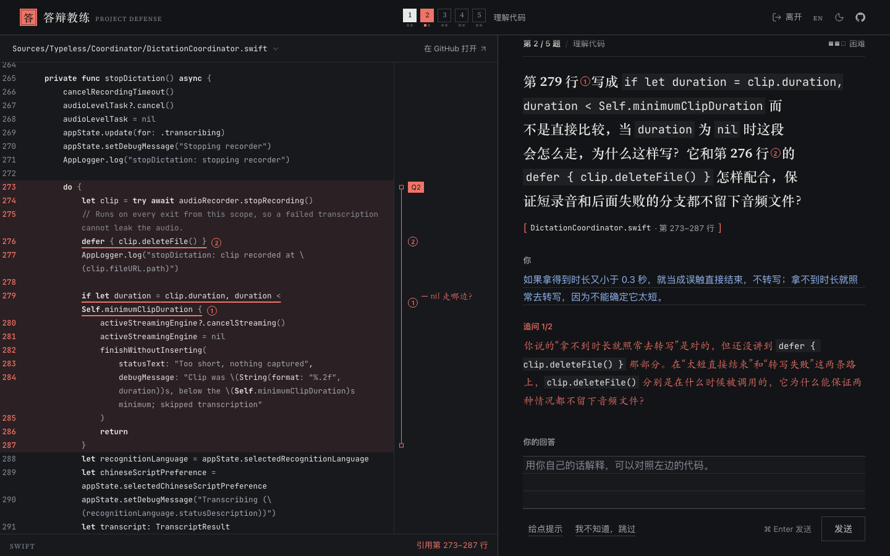
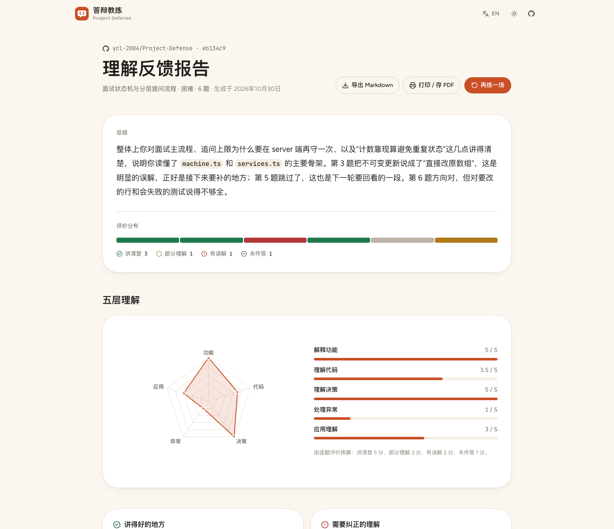
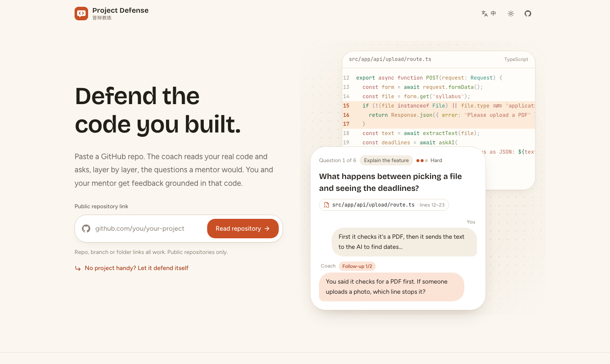

<p align="center">
  
</p>

<h1 align="center">答辯教練 · Project Defense</h1>

<p align="center">
  <strong>學生貼上公開的 GitHub 倉庫，練習把自己寫的程式碼講清楚。教練根據真實的程式碼行一層層提問，回答含糊就追問，最後寫出一份導師可以逐行核對的回饋。</strong>
</p>

<p align="center">
  <a href="https://project-defense-pink.vercel.app"></a>
  
  
  
  <a href="https://github.com/ycl-2004/Project-Defense/actions/workflows/ci.yml"></a>
</p>

<p align="center">
  <a href="https://project-defense-pink.vercel.app"><strong>打開線上網站</strong></a> ·
  <a href="#快速開始">快速開始</a> ·
  <a href="#運作方式">運作方式</a> ·
  <a href="#截圖">截圖</a> ·
  <a href="#隱私">隱私</a> ·
  <a href="#部署到-vercel">部署到 Vercel</a> ·
  <a href="#從原始碼建置">從原始碼建置</a> ·
  <a href="README.md">English</a>
</p>

在 AI 程式課上，青少年一個週末就能做出能跑的 App，卻常常說不清它是怎麼運作的。答辯教練就是為「被問到的那一刻」準備的彩排。學生貼上自己的倉庫連結，選一個想講的部分，回答五到八個問題，問題從「發生了什麼」一路問到「你會怎麼改」，每一題都指向他自己程式碼裡的具體行。

教練不打總分，只記錄證據：學生說了什麼，對照程式碼實際做了什麼。導師拿到的報告可以逐行核對，最後還附上一個小改動任務，讓學生接著做。網站沒有帳號也沒有資料庫，整場答辯只存在學生自己的瀏覽器裡。

<p align="center">
  
</p>

<p align="center"><sub>線上網站的真實一場答辯。等待 AI 的片段加速四到六倍，其餘都是實際速度。</sub></p>

> **狀態（2026-10-30）：** 已上線 <https://project-defense-pink.vercel.app>，由 Vercel 從 `main` 自動部署。版本 `0.1.0`。目前已驗證：76 個單元測試、兩個模擬 AI 的 Playwright 測試、正式環境的 `next build`、在本倉庫上用真實 DeepSeek API 走完一整場（分析 → 出題 → 追問 → 提示 → 報告），以及在本倉庫和 [`vercel/ms`](https://github.com/vercel/ms) 上執行 `npm run eval:live`，所有引用的程式碼行都和真實檔案一致。

## 快速開始

```bash
git clone https://github.com/ycl-2004/Project-Defense.git
cd Project-Defense
npm install
cp .env.example .env.local    # 在 DEEPSEEK_API_KEY 填入你的 DeepSeek 金鑰
npm run dev
```

打開 <http://localhost:3000>，貼上公開倉庫的連結；或者按 **沒有現成項目？讓它給自己答辯**，直接用本倉庫跑一場。

### 環境需求

- Node.js 20.9 以上（開發時使用 Node 24.4）與 npm。
- 一把 [DeepSeek API 金鑰](https://platform.deepseek.com/)，預設模型是 `deepseek-flash`。
- 選用：GitHub token，說明見下表。

| 變數 | 必填 | 用途 |
| --- | --- | --- |
| `DEEPSEEK_API_KEY` | 是 | 伺服器端使用的 DeepSeek 金鑰，不會傳到瀏覽器。 |
| `DEEPSEEK_MODEL` | 否 | 預設 `deepseek-flash`。 |
| `GITHUB_TOKEN` | 建議 | 細粒度 token，存取範圍選 **Public repositories (read-only)**，不勾任何權限。可以把 GitHub API 上限從每小時 60 次提高到 5,000 次，在共用主機上很重要。 |
| `ACCESS_CODE` | 否 | 設定後，訪客要先輸入這組存取碼，網站才會呼叫 AI。 |

## 為什麼做答辯教練

**題目來自真實程式碼。** 每一題都引用一個檔案和一段行號。學生看到的程式碼片段由伺服器從本場鎖定的 commit 裡截取，模型只能指向程式碼，不能憑空寫出程式碼。

**追問跟著回答走。** 學生說「它存到資料庫裡」，教練就會問存了什麼、為什麼要存、重新整理後怎麼讀回來。每題最多追問兩次，上限由伺服器強制執行。

**給證據，不給分數。** 每一題被評為「講清楚」、「部分理解」、「有誤解」或「未作答」，並把學生的原話和程式碼並列。沒有總分，報告也明確寫著它不是作弊判定。

**為教學而設計。** 學生可以要提示，也可以說「我不知道」，不會因此中斷。報告最後給導師一個具體的改動任務，因為動手改程式碼再解釋原因，比任何測驗都更能證明理解。

## 功能

**讀取倉庫**
- 接受倉庫首頁、分支和子目錄連結（`github.com/owner/repo/tree/branch/folder`），只讀公開倉庫。
- 整場答辯鎖定在同一個 commit，並略過相依套件、lock 檔、建置產物、二進位檔和超過 100 KB 的檔案。
- 讀取 README 和檔案樹後，提出三到六個「部分」，也就是學生能從頭講到尾的功能。學生也可以自己描述想被問的部分。

**答辯過程**
- 難度：**簡單**（程式碼做了什麼）、**困難**（為什麼這樣寫）、**刁鑽**（反事實、邊界情況、改需求）。
- 五到八道主問題，沿著五個層次推進：解釋功能 → 理解程式碼 → 理解決策 → 處理異常 → 應用理解。
- 程式碼就在對話旁邊：顯示整個檔案，被引用的行會高亮並捲到可見處；追問引用別的行時，程式碼面板會跟著移動。
- 提示（每題最多三次）、跳過，以及網路失敗時保留已輸入回答的重試流程。

**報告**
- 總結、每題一段的評價條，以及五層雷達圖，旁邊列出精確分數。
- 講得好的地方、需要糾正的理解、接下來要補學的主題和相關檔案，以及給導師的下一步驗證。
- 每題可以展開回顧：引用的程式碼、完整對話、依據和回饋。
- **匯出 Markdown** 產生一份獨立檔案；**列印／存 PDF** 會展開所有題目，並一律以淺色配色列印。

**全站**
- 中文和英文介面。答辯語言在開始時鎖定。
- 淺色與深色主題，預設跟隨系統，也可以手動切換。控制項支援鍵盤操作，`⌘ Enter` 送出回答。

## 運作方式



1. **分析。** 呼叫三次 GitHub API（倉庫、commit、檔案樹），再讀取 README。模型回傳專案概覽和各個部分，它提到的檔案路徑都會和檔案樹核對。
2. **出題。** 把該部分的檔案（最多 40 個、300 KB）加上行號送給模型。模型依每個層次寫一題並引用行號。每個引用都會和真實檔案核對，只要有一個不對，就把具體錯誤告訴模型請它重寫，最多三次。
3. **每一輪。** 學生回答後，模型決定要追問還是進入下一題。這一步關閉 thinking 模式，所以只要幾秒。
4. **報告。** 模型為每一題評級。學生跳過的題目依規則直接評為「未作答」；雷達圖由評級換算（講清楚 5、部分理解 3、有誤解 2、未作答 1），同樣的回答永遠畫出同樣的圖。

伺服器不保存任何狀態。瀏覽器保存本場答辯，每次請求帶上需要的內容；請求大小有上限，並用 zod 驗證。倉庫內容和學生回答在 prompt 裡都以資料區塊包住，規則只寫在系統 prompt 中，所以藏在 README 裡的指令改變不了教練的行為。

2026-10-30 用 `deepseek-flash` 對本倉庫實測：

| 步驟 | 耗時 |
| --- | --- |
| 分析倉庫 | 11 秒 |
| 出六道題 | 13–17 秒 |
| 決定是否追問 | 1.7–3.7 秒 |
| 提示 | 1.8 秒 |
| 報告 | 13–18 秒 |

設計決策記錄在 [`docs/decisions/`](docs/decisions/)，視覺系統見 [`DESIGN.md`](DESIGN.md)。

## 截圖

| 首頁 | 選擇部分 |
| --- | --- |
|  |  |
| **答辯中** | **答辯中（深色）** |
|  |  |
| **報告** | **英文介面** |
|  |  |

2026-10-30 以 Playwright 在 1440 × 900 下從本機伺服器擷取。答辯和報告畫面是 `deepseek-flash` 針對本倉庫的真實輸出。介面本身使用簡體中文。

## 隱私

- **沒有帳號，沒有資料庫。** 本場答辯（倉庫、題目、回答、報告）存在瀏覽器的 `localStorage`，鍵名 `project-defense:v1`。另有兩個 cookie 記住語言和主題（`pd-locale`、`pd-theme`）。
- **哪些資料會離開瀏覽器。** 瀏覽器把倉庫連結、選中的檔案路徑和學生的回答送到本站伺服器。伺服器從 GitHub 讀取公開檔案，再把檔案內容和回答送到 DeepSeek API，適用 DeepSeek 自己的資料政策。程式碼面板的完整檔案由瀏覽器直接從 `raw.githubusercontent.com` 讀取。
- **伺服器什麼都不留。** 請求處理完就丟棄，錯誤只記錄代碼和一句簡短說明。
- **只限公開程式碼。** 私有倉庫會被拒絕。請不要在回答裡貼上任何密鑰。

## 部署到 Vercel

1. 用 GitHub 登入 [vercel.com](https://vercel.com)。
2. **Add New → Project**，匯入 `Project-Defense`。Vercel 會自動辨識 Next.js，建置設定保持預設。
3. 在 **Environment Variables** 加上 `DEEPSEEK_API_KEY`，最好也加上 `GITHUB_TOKEN`。不想對所有人開放的話，再加上 `ACCESS_CODE`。
4. 按 **Deploy**。之後每次推送到 `main` 都會自動重新部署。
5. 打開新網站的 `/api/health` 檢查設定。它會回報 DeepSeek 金鑰是否已設定、GitHub 是否接受 token（有效的 token 上限是 5,000），但絕不會回傳金鑰本身。

API 路由的 `maxDuration` 設在 60 到 180 秒之間，在 Hobby 方案 300 秒的上限內。網站花的是擁有者的 DeepSeek 額度，帳戶裡只儲值少量金額，或設定 `ACCESS_CODE`。

## 常見問題

<details>
<summary>頁面顯示「網站還沒有配置 AI 密鑰」。</summary>

伺服器上缺少 `DEEPSEEK_API_KEY`。本機請寫進 `.env.local` 後重新啟動 `npm run dev`；Vercel 上請在 Environment Variables 加上後重新部署。
</details>

<details>
<summary>怎麼確認 GitHub token 有效？</summary>

打開 `/api/health`。`tokenAccepted: true` 而且 `limit` 是 5,000，代表 GitHub 接受了這個 token；上限是 60 則表示網站目前沒有使用 token。
</details>

<details>
<summary>顯示「GitHub 的讀取次數暫時用完了」。</summary>

沒有 token 時，GitHub 每個 IP 每小時只允許 60 次 API 請求，共用主機的 IP 很快就會用完。請把 `GITHUB_TOKEN` 設成只讀公開倉庫的細粒度 token。
</details>

<details>
<summary>可以讀私有倉庫嗎？</summary>

不行。第一版只讀公開倉庫，這樣 token 沒有任何風險，隱私邊界也最單純。
</details>

<details>
<summary>為什麼沒有總分？</summary>

幾道題證明不了理解，而一個數字很容易被當成結論。報告改為呈現逐題證據。詳見 [`docs/decisions/001-evidence-not-scores.md`](docs/decisions/001-evidence-not-scores.md)。
</details>

<details>
<summary>支援哪些程式語言？</summary>

只要原始碼是文字檔都可以。語法高亮涵蓋常見語言（TypeScript、JavaScript、Python、Go、Rust、Java、Kotlin、Swift、C/C++、C#、PHP、Ruby、Dart、Vue、Svelte 等），其他語言以純文字顯示。
</details>

## 從原始碼建置

<details>
<summary>指令</summary>

```bash
npm install
npm run dev          # http://localhost:3000
npm run lint         # ESLint（Next.js core-web-vitals + TypeScript）
npm run typecheck    # tsc --noEmit
npm test             # Vitest 單元測試，不連網
npm run test:e2e     # Playwright 主流程，會先建置並啟動，AI 和 GitHub 都是模擬的
npm run eval:live    # 選用：用真實 DeepSeek 和 GitHub 測兩個公開倉庫（需要 .env.local，花費幾美分）
npm run build && npm start
```

每次推送和 pull request，CI 都會跑 lint、型別檢查、單元測試、正式建置和 Playwright 測試，不需要任何 secrets。
</details>

## 專案結構

```text
src/
  app/                  頁面（/、/setup、/interview、/report）與 api/ 下的 API 路由
  components/           首頁、設定、答辯、報告與共用介面；ui/ 是 shadcn/ui 元件
  lib/
    domain.ts           共用型別與 zod schema
    config.ts           所有產品上限集中在這裡
    github/             連結解析、檔案過濾、GitHub 客戶端
    interview/          層次、狀態機、引用、評分、prompt、Markdown 匯出
    llm/                DeepSeek 客戶端，含 JSON 檢查與重試
    server/             API 路由背後的服務、相依組裝、HTTP 外殼
    client/             瀏覽器狀態、API 客戶端、語法高亮、hooks
    i18n/messages.ts    所有介面文字的中英文版本
tests/                  Vitest 單元測試（假 GitHub、假模型）
e2e/                    Playwright 主流程測試
evals/                  選用的真實 API 評測
docs/                   決策記錄、截圖、申請用介紹
```

## 版本與發布

版本號寫在 `package.json`（目前 `0.1.0`）。目前還沒有打 tag 的發布版本，部署後的網站會跟隨 `main`。

## 已知限制

- 只支援 GitHub 公開倉庫，不支援其他平台。
- 一個部分最多讀 40 個檔案、300 KB；超過 100 KB 的檔案會被略過，檔案清單只列出前 1,500 個給模型。
- 教練也會出錯。評級是給導師核對的證據，不是成績。
- 報告只存在一個瀏覽器裡，目前沒有分享連結。
- 只在 Chromium 的桌面與 390 px 手機寬度下測試過，Safari 和 Firefox 尚未驗證。配色使用 CSS `light-dark()`，需要 Safari 17.5、Chrome 123 或 Firefox 120 以上。
- 回答不是串流顯示，較長的步驟會顯示進度。
- 除了選用的存取碼，沒有其他流量限制。

## 授權

尚未選定授權條款。在加入授權檔案之前，作者保留所有權利。
